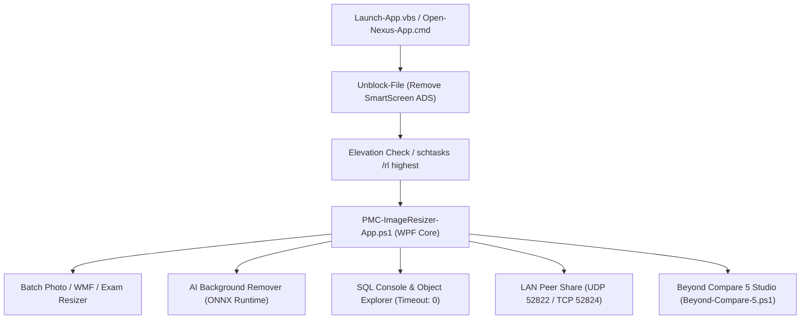

# Nexus Enterprise Studio

[](https://microsoft.com)
[]()
[]()
[](https://github.com/Mandar023/Nexus-Enterprise-Studio/releases/latest)
[](LICENSE)
[](https://github.com/Mandar023/Nexus-Enterprise-Studio/stargazers)
[](https://github.com/Mandar023/Nexus-Enterprise-Studio/network/members)
[](https://github.com/Mandar023/Nexus-Enterprise-Studio/issues)

An enterprise-grade, zero-dependency desktop workspace designed for high-throughput image and document optimization, municipal multi-server network consolidation, native code and folder comparison (**Beyond Compare 5 Studio**), and an integrated **SSMS-grade SQL Management Console** with peer-to-peer LAN sharing.

---

> [!TIP]
> 🚀 **[Explore Interactive 3D Showcase](https://mandar023.github.io/Nexus-Enterprise-Studio/)** &nbsp;|&nbsp; 📦 **[Download Latest Release (v5.5.0 Portable ZIP)](https://github.com/Mandar023/Nexus-Enterprise-Studio/releases/latest)** — No installation required. Extract and double-click `Launch-App.vbs`.

---

## Key Features

### 1. Batch Photo & Document Optimizer
- **Ultra-Fast Multi-Threaded Compression**: Batch optimize JPEG, PNG, BMP, TIFF, and WebP images.
- **Crystal Reports WMF Vector Optimizer**: Specialized vector downscaling algorithm that compresses large WMFs to $\le 25\text{ KB}$ while strictly preserving vector line sharpness and Crystal Report layout compatibility.
- **Govt Exam Photo & Signature Resizer**: Automated constraint enforcement for government exam forms (specific KB limits, strict pixel dimensions, DPI adjustments).
- **AI Background Removal**: 100% offline background subtraction powered by an embedded U2Net ONNX runtime model (`bin/onnxruntime.dll`).
- **PDF & Document Extraction**: Convert multi-page PDFs to images, extract property card photos, and batch process document archives.

### 2. Beyond Compare 5 (Diff & Merge Studio)
- **100% Native Zero-Dependency Offline Execution**: Matches Scooter Software Beyond Compare 5 interface and capabilities 1:1.
- **Text & Code Comparison**: Dual-pane editor with Myers and Patience diff algorithms, character-level difference highlighting, inline editing, and 3-way merge.
- **Folder Comparison & Sync**: Side-by-side folder directory trees with recursive traversal, timestamp/size/CRC32 checksum comparisons, and bi-directional sync actions.
- **Table / CSV & Hex Inspection**: Structured grid diff for tabular data and byte-level hex comparison.

### 3. Enterprise SQL Management Console
- **SSMS-Grade Studio**: Multi-tab query environment with independent tab lifecycles (`Ctrl+N` new tab, `Ctrl+W` close tab, `F5` execute, `Ctrl+F5` parse).
- **Live Object Explorer**: Interactive tree view of Databases, Tables, Views, Stored Procedures, Functions, Columns, and Triggers with on-demand lazy loading.
- **Unlimited Execution Timeout**: Configured with `CommandTimeout = 0` (No Timeout / Infinite), allowing heavy batch loops (e.g. multi-owner tax calculations) and DDL operations to run without client-side timeout abortions.
- **Safe Test Mode**: Run complex queries wrapped in an isolated `BEGIN TRAN ... ROLLBACK` transaction to preview rows affected with zero risk to production data.
- **DDL Wizard & User Access Manager**: Built-in script generator and database permission auditor.

### 4. LAN Peer-to-Peer Share & Live Network Updater
- **Automated UDP Peer Discovery**: Instant peer detection across local subnets on UDP port `52822`.
- **Direct High-Speed TCP Transfer**: Blazing-fast file transmission between network PCs on TCP port `52824`.
- **Web Browser Share**: Built-in HTTP web server on TCP port `52826` for browser-based downloads on mobile devices or non-app machines.
- **Central SQL Hub Synchronization**: Heartbeat telemetry and automated update alerts through central SQL Server table `_NexusAppReleases`.

### 5. Smart Elevation & Launcher Automation
- **Zero-Prompt Administrator Elevation**: Leverages Windows Scheduled Tasks (`/rl highest`) for instant administrative launch with zero UAC confirmation boxes.
- **SmartScreen Elimination**: Strips `Zone.Identifier` alternate data streams (`Unblock-File`) to prevent "Windows protected your PC" warnings.
- **Non-Admin Fallback**: Intelligently detects user group privileges (`whoami /groups`); if run under a standard user account, it launches directly without showing password prompts or blocking execution.

### 6. Multi-Server Consolidator & Ward Reference Extractor
- **Multi-Server Unification**: High-speed synchronization engine consolidating photos and plans from distributed municipal server shares (e.g. `192.168.1.11`, `192.168.1.22`) directly into central repository servers (e.g. `192.168.1.19` `PropertyImage` and `PlanPhoto`).
- **O(1) Deduplication Engine**: Pre-indexes all target files in memory to eliminate redundant network I/O, seamlessly ignoring existing common files and synchronizing only newly identified plans and photos.
- **Ward Path Extractor**: Automated recursive crawler extracting ward structures and exporting:
  - **Option A**: `Photos_Paths.txt` and `Plans_Paths.txt` directory listings.
  - **Option B**: Full recursive file inventories (`Photos_AllFiles.txt`, `Plans_AllFiles.txt`).
  - **Option C**: Comprehensive Excel/CSV dual-column alignment (`Ward_Photos_And_Plans_Paths.csv`) mapping Ward Name, Photo Path, Plan Path, Photo Count, Plan Count, and Status.


---

## Architecture Overview



---

## Directory Structure

```text
├── PMC-ImageResizer-App.ps1       # Main Application Suite (WPF / C# Engine)
├── Beyond-Compare-5.ps1           # Beyond Compare 5 Studio (Text / Folder / Hex Diff)
├── Launch-App.vbs                 # Direct zero-prompt Admin launcher (silent)
├── Launch-BeyondCompare.vbs       # Direct Beyond Compare launcher (silent)
├── Open-Nexus-App.cmd             # Enterprise batch launcher with self-elevation
├── Beyond-Compare-5.cmd           # Beyond Compare 5 batch launcher
├── Create-Desktop-Shortcut.cmd    # 1-Click Desktop shortcut installer (.cmd)
├── Create-Desktop-Shortcut.vbs    # 1-Click Desktop shortcut installer (.vbs)
├── Enable-LanShareFirewall.cmd    # Automated firewall rule setup for LAN ports
├── bin/                           # Native ONNX runtime & AI Background Removal DLLs
│   ├── AiBackgroundRemover.dll
│   ├── Microsoft.ML.OnnxRuntime.dll
│   ├── onnxruntime.dll
│   ├── System.Buffers.dll
│   ├── System.Memory.dll
│   ├── System.Numerics.Vectors.dll
│   ├── System.Runtime.CompilerServices.Unsafe.dll
│   └── u2netp.onnx
├── nexus_app.ico                  # Application Icon
├── nexus_app_logo.png             # Application Logo
├── sql-connections.sample.json    # Sanitized database connection string template
├── .gitignore                     # Repository exclusion rules
├── LICENSE                        # MIT License
└── README.md                      # Documentation
```

---

## Quick Start Guide

### Prerequisites
- **Operating System**: Windows 10, Windows 11, or Windows Server 2016+ (x64)
- **PowerShell**: Windows PowerShell 5.1 (Built into Windows) or PowerShell 7+
- **.NET Framework**: .NET Framework 4.7.2 or higher (Built into modern Windows)

### Running the Application

1. **Option 1 (Recommended)**: Double-click [`Launch-App.vbs`](file:///Launch-App.vbs) to start the app silently with administrative privileges and zero command window flashing.
2. **Option 2**: Run [`Open-Nexus-App.cmd`](file:///Open-Nexus-App.cmd) for console-assisted startup and diagnostic logging.
3. **Beyond Compare 5**: Double-click [`Launch-BeyondCompare.vbs`](file:///Launch-BeyondCompare.vbs) or [`Beyond-Compare-5.cmd`](file:///Beyond-Compare-5.cmd).
4. **Desktop Shortcuts**: Run [`Create-Desktop-Shortcut.cmd`](file:///Create-Desktop-Shortcut.cmd) once to place clean shortcuts on your Desktop.

---

## Keyboard Shortcuts

| Shortcut | Context | Action |
| :--- | :--- | :--- |
| `F5` | SQL Console | Execute selected query or full batch |
| `Ctrl + F5` | SQL Console | Parse and validate SQL syntax (`SET PARSEONLY ON`) |
| `Ctrl + N` | SQL Console | Open a new independent SQL query tab |
| `Ctrl + W` | SQL Console | Close current SQL query tab |
| `Ctrl + L` | SQL Console | Clear query editor and result grids |
| `Ctrl + Shift + S` | Anywhere | Open or focus the Admin SQL Console |
| `Ctrl + D` | Anywhere | Launch Beyond Compare 5 Diff Studio |
| `Ctrl + Shift + N` | Anywhere | Launch a new independent application instance |
| `Alt + Break` | SQL Console | Cancel currently executing SQL query |

---

## Database Configuration

Copy `sql-connections.sample.json` to `sql-connections.json` and customize your server connection strings:

```json
[
  {
    "Name": "Production Server",
    "ConnectionString": "data source=192.168.1.10;initial catalog=MyDatabase;User ID=sa;Password=Secret"
  }
]
```

> [!NOTE]
> `sql-connections.json` is automatically excluded by `.gitignore` to prevent sensitive credentials from ever being committed to source control.

---

## License

This project is licensed under the [MIT License](LICENSE).
